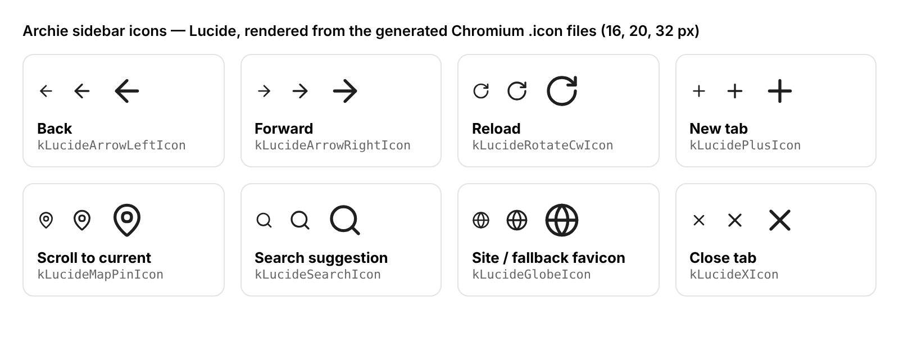

# Archie

A minimal Chromium fork. Tabs live in a sidebar on the left like in Arc.
You never have to log in, and there are no onboarding, promo or "try this
feature" popups.

Archie is a small set of patches plus build scripts on top of upstream
Chromium (currently **156.0.8078.47**, see `CHROMIUM_VERSION`). This is the
same approach ungoogled-chromium and Helium use. Keeping the diff small makes
moving to a new Chromium release cheap.

## What you get

| | How |
|---|---|
| **Tab sidebar on the left** | Chromium's native vertical tab strip, turned on by default. Tab titles are never abbreviated: they wrap onto as many lines as they need. Every tab has an ✕ close button (not just the one you hover). Pinned tabs, tab groups, drag to reorder, collapse to icons. |
| **Sidebar bottom section** | Pinned to the bottom of the sidebar. It has a pill for the tab you were on before (click to jump back), a button that scrolls the tab list to your current tab, and Back, Forward, Reload and **+** buttons. Back/Forward/Reload dim when they can't be used. |
| **Search box for new tabs** | **+** opens a floating search box with address-bar suggestions as you type (history, bookmarks, open tabs, search suggestions). Use ↑/↓ to pick one, Enter or click to open it in a new tab, and Esc or clicking elsewhere to close it without opening a tab. Middle-click on **+** still pastes and goes. |
| **Tab groups** | Native tab groups, shown as folders in the sidebar (right-click a tab > *Add tab to group*). |
| **Profiles** | Native Chromium profiles, created locally with no sign-in step. Switch between them from the avatar menu. Each profile has its own tabs, bookmarks, history and cookies, like Arc's Spaces. |
| **Bookmarks** | Native bookmarks: ★ in the address bar, `Ctrl+Shift+O` for the manager, and the bookmarks side panel. The bookmarks bar is off by default to keep things clean (`Ctrl+Shift+B` toggles it). |
| **No login** | Sign-in and sync are off by default and never prompted. You can turn them on yourself in Settings if you want. |
| **No popups** | No first-run intro, no "What's New" tab, no default-browser, pin-to-taskbar or PDF prompts, no "Google API keys missing" bar, no in-product-help bubbles, no search-engine choice screen, no profile picker at startup. |
| **Separate profile dir** | `~/.config/archie`, so it never touches a stock Chromium profile. |

## Repository layout

```
CHROMIUM_VERSION        upstream tag Archie is based on
config/args.gn          GN build arguments (release, no Google API keys)
branding/BRANDING       product name / company strings
patches/series          the patches, applied in order
patches/archie/...      ui/, no-signin/, no-popups/, branding/
scripts/fetch.sh        get depot_tools + Chromium at CHROMIUM_VERSION
scripts/prepare.sh      apply patches, branding and string rebrand
scripts/rebrand.py      "Chromium" -> "Archie" in UI strings, keeps translations
scripts/build.sh        gn gen + autoninja
scripts/package.sh      Linux tarball with launcher and .desktop file
scripts/preview.sh      try Archie's defaults on a Chrome you already have
scripts/verify_patches.py  check patches apply to upstream without a checkout
scripts/lucide_to_icon.py  convert Lucide SVGs into Chromium .icon files
icons/lucide/           Lucide SVG sources used by Archie
```

## Try it in 10 seconds (no build)

`scripts/preview.sh` launches a Chromium or Chrome you already have (version
153 or newer) with a separate profile seeded with Archie's defaults:

```sh
scripts/preview.sh                 # finds chromium / google-chrome on PATH
scripts/preview.sh /path/to/chrome # or point it at a binary
```

This is only a preview of the defaults. A real Archie build also removes
popups that need a source change, and has the sidebar changes (full titles,
✕ on every tab, the bottom section and the search box).

## Build

You need Linux (x64), about 100 GB of free disk, 16 GB+ of RAM, and a few
hours for the first build. See Chromium's
[Linux build instructions](https://chromium.googlesource.com/chromium/src/+/main/docs/linux/build_instructions.md)
for the system requirements.

```sh
scripts/fetch.sh      # depot_tools + Chromium source (+ install-build-deps, needs sudo)
scripts/prepare.sh    # apply Archie patches and branding
scripts/build.sh      # -> build/chromium/src/out/Archie/chrome
scripts/package.sh    # -> dist/archie-<version>-linux-x64.tar.xz
```

Set `CHROMIUM_DIR=/big/disk/chromium` to keep the checkout somewhere else.
`scripts/prepare.sh` is safe to re-run. `scripts/prepare.sh --reset`
discards local changes in the checkout and starts again from a clean tree.

macOS and Windows builds use the same patches. The scripts are only tested
on Linux so far.

## Updating Chromium

1. Put the new tag in `CHROMIUM_VERSION`. Current releases are listed on
   <https://chromiumdash.appspot.com/releases>.
2. Run `python3 scripts/verify_patches.py`. It downloads only the files the
   patches touch and reports any patch that no longer applies. CI runs this
   check on every push and once a week.
3. Fix any failing patches, then run `scripts/fetch.sh && scripts/prepare.sh --reset && scripts/build.sh`.

## Icons

Archie's sidebar uses [Lucide](https://lucide.dev) icons (ISC license, see
`icons/lucide/LICENSE`): Back, Forward, Reload, New tab, the "scroll to
current tab" pin, the search box's suggestion icons, and the ✕ on tabs.



Chromium draws icons from its own `.icon` vector format, not SVG.
`scripts/lucide_to_icon.py` (needs `pip install picosvg`) turns a Lucide SVG
into a `.icon` file. It converts the rounded strokes into filled shapes, so
the icon looks exactly like Lucide at any size. To add or swap an icon:

1. Copy the SVG from Lucide into `icons/lucide/`.
2. Run `python3 scripts/lucide_to_icon.py <out_dir> icons/lucide/*.svg`.
3. Put the output in `patches/archie/ui/lucide-icons.patch`, list it in
   `components/vector_icons/BUILD.gn`, and use it in C++ as
   `vector_icons::kLucide<Name>Icon`.

## Writing a patch

Each patch is a plain `git diff` against `src/`, with a short explanation at
the top. Make the change in the checkout, then run
`git -C build/chromium/src diff -- <files> > patches/archie/<area>/<name>.patch`
and add the patch to `patches/series`.

Prefer changing a default, such as a pref registration or a feature switch,
over deleting code. Patches like that rarely conflict when Chromium updates.

## License

BSD-3-Clause, same as Chromium. See `LICENSE`.
