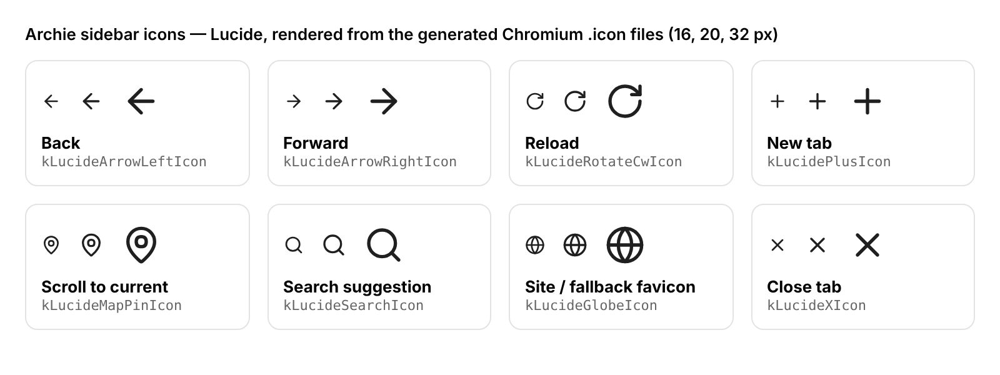

# Developing Archie

Archie is a small set of patches plus build scripts on top of upstream
Chromium (see `CHROMIUM_VERSION`), the same approach ungoogled-chromium and
Helium use. Keeping the diff small makes moving to a new Chromium release
cheap.

## Repository layout

```
ARCHIE_VERSION          Archie's own version, compared against GitHub releases
CHROMIUM_VERSION        upstream tag Archie is based on
config/args.gn          GN build arguments (release, no Google API keys)
branding/BRANDING       product name / company strings
patches/series          the patches, applied in order
patches/archie/...      ui/, no-signin/, no-popups/, branding/
scripts/fetch.sh        get depot_tools + Chromium at CHROMIUM_VERSION
scripts/prepare.sh      apply patches, branding and string rebrand
scripts/rebrand.py      "Chromium" -> "Archie" in UI strings, keeps translations
scripts/build.sh        gn gen + autoninja
scripts/package.sh      Linux tarball with launcher and .desktop file
scripts/windows/        the same steps for Windows (.bat, low memory by default)
scripts/make_args.py    writes args.gn, with config/args-low-memory.gn merged in
scripts/write_version_header.py  bakes ARCHIE_VERSION into the build
scripts/release.sh      publish the tarball as a GitHub release (with patch notes)
scripts/preview.sh      try Archie's defaults on a Chrome you already have
scripts/verify_patches.py  check patches apply to upstream without a checkout
scripts/lucide_to_icon.py  convert Lucide SVGs into Chromium .icon files
icons/lucide/           Lucide SVG sources used by Archie
```

## Try it in 10 seconds (no build)

`scripts/preview.sh` launches a Chromium or Chrome you already have (version
153 or newer) with a separate profile seeded with Archie's defaults:

```sh
scripts/preview.sh                 # finds chromium / google-chrome on PATH
scripts/preview.sh /path/to/chrome # or point it at a binary
```

This is only a preview of the defaults. A real Archie build also removes
popups that need a source change, and has the sidebar changes (full titles,
✕ on every tab, the bottom section and the search box).

## Building on Linux

You need Linux (x64), about 100 GB of free disk, 16 GB+ of RAM, and a few
hours for the first build. See Chromium's
[Linux build instructions](https://chromium.googlesource.com/chromium/src/+/main/docs/linux/build_instructions.md)
for the system requirements.

```sh
scripts/fetch.sh      # depot_tools + Chromium source (+ install-build-deps, needs sudo)
scripts/prepare.sh    # apply Archie patches and branding
scripts/build.sh      # -> build/chromium/src/out/Archie/chrome
scripts/package.sh    # -> dist/archie-<version>-linux-x64.tar.xz
```

Set `CHROMIUM_DIR=/big/disk/chromium` to keep the checkout somewhere else.
`scripts/prepare.sh` is safe to re-run. `scripts/prepare.sh --reset`
discards local changes in the checkout and starts again from a clean tree.

macOS and Windows builds use the same patches. The scripts are only tested
on Linux so far.

## Building on Windows

The Windows scripts live in `scripts\windows\`. Run them from **Command
Prompt** (`cmd.exe`), not PowerShell: Chromium's tools don't set themselves up
correctly from PowerShell the first time.

### What you need

- Windows 10 or 11 (x64), and an NTFS drive with **about 100 GB free**.
- **Visual Studio 2026** (the free Community edition is fine) with the
  **Desktop development with C++** workload and **MFC/ATL support**.
- **Windows 11 SDK 10.0.28000.2270** with **Debugging Tools for Windows**
  (tick it in the Visual Studio Installer, or add it later under Programs and
  Features > Windows Software Development Kit > Change).
- [Git for Windows](https://git-scm.com/download/win).
- For publishing: the [GitHub CLI](https://cli.github.com), logged in.

### Low memory by default

The Windows scripts assume about **8 GB of RAM to spare**, so a 16 GB computer
stays usable while it builds:

- 4 parallel compile jobs (`set ARCHIE_JOBS=2` for even less, `8` for more).
- No link-time optimization, which alone can need 16+ GB
  (see `config/args-low-memory.gn`). Archie runs a little slower than an
  official Chrome build, which is not noticeable day to day.

Let Windows manage the page file (System > About > Advanced system settings >
Performance > Advanced > Virtual memory > "Automatically manage"), so a
memory spike slows the build down instead of crashing it.

### Build

```bat
git clone https://github.com/nicklitvin/archie
cd archie
rem Chromium source into C:\archie-build (an hour or more)
scripts\windows\fetch.bat
rem Apply Archie's patches
scripts\windows\prepare.bat
rem Compile. The first build can take most of a day.
scripts\windows\build.bat
rem Makes dist\archie-<version>-windows-x64-setup.exe
scripts\windows\package.bat
rem Publish it as a GitHub release
scripts\windows\release.bat notes.md
```

The installer puts Archie in `%LOCALAPPDATA%\Archie` for the current user, with
its own profile, separate from any other Chromium or Chrome.

You can stop `build.bat` (Ctrl+C) and run it again later; it carries on where it
stopped. Set `CHROMIUM_DIR` before running the scripts to put the checkout
somewhere other than `C:\archie-build` (the path must not contain spaces).

### Let Claude do it

Open the `archie` folder in Claude Code on your computer and ask it to "build
Archie on Windows". It runs the scripts above, and because this is the first
real compile of the patches, it can fix any compile errors as they come up.

## Releasing

Running copies of Archie compare their version (`ARCHIE_VERSION`) with the
newest release on GitHub. They show your release notes in **Patch notes**.

1. Bump `ARCHIE_VERSION` (e.g. `0.1.0` → `0.2.0`).
2. Build and package: `scripts/prepare.sh && scripts/build.sh && scripts/package.sh`
   on Linux, or the `scripts\windows\` scripts on Windows.
3. Write the patch notes in a Markdown file, then run
   `scripts/release.sh notes.md` (or `scripts\windows\release.bat notes.md`).
   This creates the release `v0.2.0` with every package in `dist/` attached
   (needs the GitHub CLI, `gh`).

Release tags must look like `v1.2.3`. Drafts and pre-releases are ignored.
To check a different repository (for example a fork), set
`ARCHIE_UPDATE_REPO=owner/repo` when running `scripts/prepare.sh`.

## Updating Chromium

1. Put the new tag in `CHROMIUM_VERSION`. Current releases are listed on
   <https://chromiumdash.appspot.com/releases>.
2. Run `python3 scripts/verify_patches.py`. It downloads only the files the
   patches touch and reports any patch that no longer applies. CI runs this
   check on every push and once a week.
3. Fix any failing patches, then run `scripts/fetch.sh && scripts/prepare.sh --reset && scripts/build.sh`.

## Icons

Archie's sidebar uses [Lucide](https://lucide.dev) icons (ISC license, see
`icons/lucide/LICENSE`): Back, Forward, Reload, New tab, the "scroll to
current tab" pin, the search box's suggestion icons, and the ✕ on tabs.



Chromium draws icons from its own `.icon` vector format, not SVG.
`scripts/lucide_to_icon.py` (needs `pip install picosvg`) turns a Lucide SVG
into a `.icon` file. It converts the rounded strokes into filled shapes, so
the icon looks exactly like Lucide at any size. To add or swap an icon:

1. Copy the SVG from Lucide into `icons/lucide/`.
2. Run `python3 scripts/lucide_to_icon.py <out_dir> icons/lucide/*.svg`.
3. Put the output in `patches/archie/ui/lucide-icons.patch`, list it in
   `components/vector_icons/BUILD.gn`, and use it in C++ as
   `vector_icons::kLucide<Name>Icon`.

## Writing a patch

Each patch is a plain `git diff` against `src/`, with a short explanation at
the top. Make the change in the checkout, then run
`git -C build/chromium/src diff -- <files> > patches/archie/<area>/<name>.patch`
and add the patch to `patches/series`.

Prefer changing a default, such as a pref registration or a feature switch,
over deleting code. Patches like that rarely conflict when Chromium updates.
